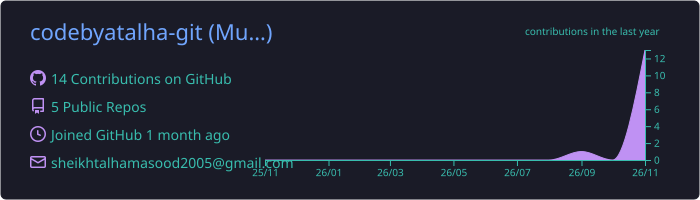
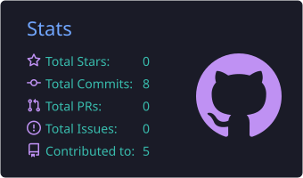
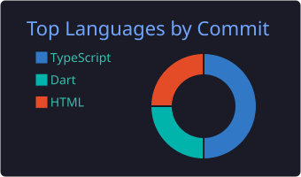
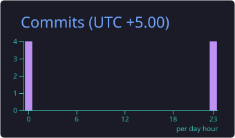

<!-- Animated header -->
<div align="center">


<!-- Typing animation -->
<a href="https://github.com/codebyatalha-git">
  
</a>

<br/>


</div>

---

## 🧑‍💻 About Me

```js
const talha = {
  name: "Talha",
  github: "codebyatalha-git",
  role: "Software Developer",
  currentlyBuilding: ["Delivery & field-ops apps", "Dashboards", "Fulfillment tools"],
  currentlyLearning: ["System design", "Cloud & DevOps", "AI-assisted development"],
  funFact: "I debug with coffee ☕ and console.log() 😄",
};
```

- 🔭 Building products end to end, from UI to backend
- 🌱 Learning something new every week
- 💬 Ask me about **Flutter, Next.js, dashboards, and shipping fast**
- ⚡ Open to collaborations and cool ideas

---

## 🛠️ Tech Stack

<div align="center">


</div>

---

## 🚀 Featured Projects

<div align="center">

| Project | What it is |
|:--|:--|
| 🚚 [**dispatch_go**](https://github.com/codebyatalha-git/dispatch_go) | Last-mile delivery & field-ops driver app (Flutter) |
| 📦 [**fulfillhq**](https://github.com/codebyatalha-git/fulfillhq) | Order fulfillment management platform |
| 🎧 [**supportops**](https://github.com/codebyatalha-git/supportops) | Support operations & ticket workflow dashboard |
| 💸 [**mmas-money-tracker**](https://github.com/codebyatalha-git/mmas-money-tracker) | Personal money & expense tracker |

</div>

---

## 📊 GitHub Stats

<div align="center">







</div>

---

## 🐍 Contribution Snake

<div align="center">


</div>

> The snake appears after the first run of the **Generate Snake** workflow (Actions tab → Run workflow).

---

## 🤝 Let's Connect

<div align="center">

<a href="https://github.com/codebyatalha-git"></a>
<a href="mailto:sheikhtalhamasood2005@gmail.com"></a>
<!-- Add more: LinkedIn, Instagram, Portfolio -->
<!-- <a href="https://linkedin.com/in/YOUR-HANDLE"></a> -->

<br/><br/>


</div>


